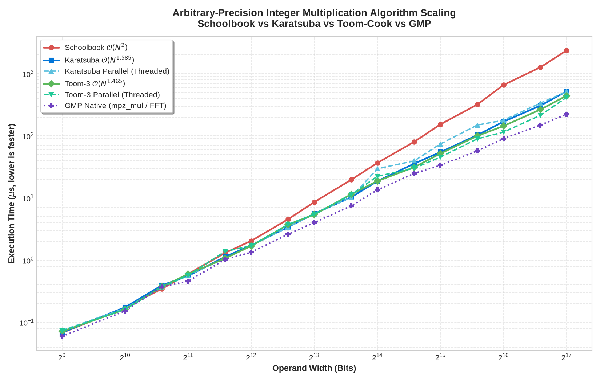

# High-Performance Integer Multiplication: Schoolbook, Karatsuba & Toom-Cook (with Multi-Threading & GMP)

A modern C++20 arbitrary-precision multiplication suite comparing classical Schoolbook ($O(n^2)$), Karatsuba ($O(n^{\log_2 3}) \approx O(n^{1.585})$), and Toom-Cook 3-way / Toom-3 ($O(n^{\log_3 5}) \approx O(n^{1.465})$) algorithms. Features zero-copy limb-slicing optimizations, thread-pool parallelization, race-condition verification under ThreadSanitizer, and automated Gnuplot scaling visualization.



---

## Key Highlights

- **Algorithmic Hierarchy**:
  - **Schoolbook** ($O(n^2)$): Minimal overhead; optimal for operands below the recursion threshold ($\le 32$ limbs / 2,048 bits).
  - **Karatsuba** ($O(n^{1.585})$): 2-way divide-and-conquer reducing 4 sub-multiplications to 3.
  - **Toom-Cook 3-way (Toom-3)** ($O(n^{1.465})$): Evaluates degree-2 polynomial representations at $\{0, 1, -1, 2, \infty\}$, reducing 9 multiplications to 5.
- **Memory Optimizations**:
  - Zero-heap operand slicing using GMP's `mpz_roinit_n` read-only limb structures.
  - In-place limb-level recombination via `mpn_add` and `mpn_add_n` to eliminate intermediate copies and bit shifts.
  - Preallocated scratch capacities (`mpz_init2`) preventing reallocations during recursive evaluation.
  - Safe operand aliasing support ($a \times b \to a$, $a \times a \to a$).
- **Multi-Threading & Concurrency**:
  - Worker thread pool (`km::ThreadPool`) parallelizing independent recursive sub-problems for large operands ($\ge 256$ limbs).
  - Verified race-condition free under **ThreadSanitizer** (`TSAN`).
- **Complete `mise` Automation**:
  - Reproducible workflow tasks for building, testing, benchmarking, sanitizers, and plotting.

---

## Project Structure

```text
├── CMakeLists.txt              # Modern target-based CMake build configuration
├── mise.toml                   # Mise task runner configuration
├── .clang-format               # Code formatting rules
├── include/
│   └── karatsuba/
│       ├── karatsuba.hpp       # Karatsuba multiplication API
│       ├── schoolbook.hpp      # Schoolbook multiplication API
│       ├── toom3.hpp           # Toom-Cook 3-way multiplication API
│       ├── limb_utils.hpp      # Zero-copy limb slicing utilities
│       ├── thread_pool.hpp     # Multi-threaded worker pool
│       ├── parser.hpp          # Arbitrary-precision base parser (bin/hex/dec)
│       ├── timer.hpp           # Monotonic stopwatch timer
│       └── terminal_color.hpp  # ANSI color support
├── src/                        # Core library implementations
├── apps/
│   └── karatsuba_cli.cpp       # Interactive CLI calculator & showcase
├── benchmarks/
│   └── benchmark.cpp           # Multi-algorithm performance benchmark
├── scripts/
│   ├── generate_plots.sh       # Automated benchmark runner & plot generator
│   ├── plot_benchmark.gp       # Gnuplot script for dual-panel curves
│   └── plot_benchmark.py       # Python / Matplotlib fallback renderer
└── tests/                      # 40 automated unit & concurrency tests
```

---

## Quick Start with `mise`

The project is automated with [`mise`](https://mise.jdx.dev):

```sh
# Build all targets (Release mode)
mise run build

# Run all 40 unit and concurrency tests
mise run test

# Launch the interactive CLI showcase
mise run cli

# Run performance benchmarks
mise run benchmark

# Generate benchmark curves (benchmark_plot.png & benchmark_plot.svg)
mise run plot

# Check memory safety with AddressSanitizer and UndefinedBehaviorSanitizer
mise run sanitize

# Check thread safety and race conditions with ThreadSanitizer (TSAN)
mise run tsan

# Auto-format codebase
mise run format
```

> **Note for sandboxed environments**: If running in an environment where `~/.local` is read-only, prefix commands with:
> `MISE_STATE_DIR=/tmp/mise/state MISE_CACHE_DIR=/tmp/mise/cache MISE_DATA_DIR=/tmp/mise/data MISE_YES=1 mise run <task>`

---

## Benchmark Scaling Results

Measurements taken on an x86_64 Linux machine (GCC 16.2.1, GMP 6.3.0). Median execution times are reported in microseconds ($\mu$s) per product (lower is faster):

| Operand Bits | Limbs | Schoolbook ($\mu$s) | Karatsuba ($\mu$s) | Toom-3 ($\mu$s) | Parallel ($\mu$s) | GMP Native ($\mu$s) | Top Speedup |
| ---: | ---: | ---: | ---: | ---: | ---: | ---: | ---: |
| 512 | 8 | 0.07 | 0.07 | 0.07 | 0.07 | 0.06 | *Base Case* |
| 2,048 | 32 | 0.51 | 0.53 | 0.54 | 0.54 | 0.45 | *Base Case* |
| 4,096 | 64 | 2.13 | 1.67 | 1.79 | 1.70 | 1.34 | **1.27x** |
| 8,192 | 128 | 9.01 | 5.71 | 6.22 | 6.14 | 4.12 | **1.58x** |
| 16,384 | 256 | 37.16 | 17.65 | 21.98 | 25.84 | 12.37 | **2.10x** |
| 32,768 | 512 | 153.96 | 60.26 | 65.08 | 48.90 | 43.55 | **3.15x** |
| 65,536 | 1,024 | 585.85 | 186.31 | 195.36 | 114.57 | 100.73 | **5.11x** |
| 131,072 | 2,048 | 2,334.45 | 561.27 | 547.15 | 361.94 | 238.61 | **6.45x** |

### Algorithmic Crossover Points
1. **$\le 2,048$ bits ($\le 32$ limbs)**: Schoolbook $O(n^2)$ is optimal due to zero recursion overhead.
2. **$\sim 4,096$ bits ($64$ limbs)**: Karatsuba $O(n^{1.585})$ overtakes Schoolbook.
3. **$\ge 32,768$ bits ($\ge 512$ limbs)**: Multi-threaded parallel execution significantly outpaces single-threaded multiplication.
4. **$\ge 131,072$ bits ($\ge 2,048$ limbs)**: Toom-3 $O(n^{1.465})$ surpasses single-threaded Karatsuba, with Parallel Toom-3 delivering **$> 6\times$ speedup** over Schoolbook.

---

## CLI Usage

The `karatsuba_cli` executable provides interactive demonstrations and arbitrary-precision calculations:

```sh
# Run interactive multi-algorithm demonstration
./build/karatsuba_cli

# Multiply arbitrary binary numbers
./build/karatsuba_cli 0b110010101 0b1011101

# Multiply arbitrary hex numbers
./build/karatsuba_cli 0x1A4F 0x2B

# Multiply large decimal numbers
./build/karatsuba_cli 12345678901234567890 98765432109876543210

# Benchmark a random 65,536-bit multiplication with multi-threading
./build/karatsuba_cli --random 65536 --parallel
```

### CLI Flags

| Flag | Description | Default |
| :--- | :--- | :--- |
| `-h, --help` | Display usage and help message | - |
| `-v, --version` | Display version and GMP info | - |
| `-b, --base <BASE>` | Force input base (2, 10, 16, auto) | `auto` |
| `-c, --cutoff <N>` | Karatsuba recursion cutoff in limbs | `32` |
| `-t, --toom-cutoff <N>` | Toom-3 recursion cutoff in limbs | `64` |
| `-p, --parallel-cutoff <N>` | Multi-threading threshold in limbs | `256` |
| `--parallel` | Enable parallel recursive branches | `false` |
| `-r, --random <BITS>` | Benchmark random operands of given bit width | - |
| `-V, --verbose` | Show detailed operand and limb breakdown | `false` |
| `-q, --quiet` | Output only product in decimal | `false` |

---

## Plotting Benchmark Data

To reproduce the benchmark curves:

```sh
mise run plot
```

This runs `scripts/generate_plots.sh`:
1. Executes `karatsuba_benchmark` across sizes from 8 to 2,048 limbs.
2. Generates `benchmark_results.csv` and `benchmark_results.dat`.
3. Renders `benchmark_plot.png` and `benchmark_plot.svg` using Gnuplot (`scripts/plot_benchmark.gp`), falling back to Matplotlib (`scripts/plot_benchmark.py`) if Gnuplot is not installed.

---

## Testing & Quality Assurance

The suite includes 40 unit and concurrency tests:
- **Zero & Identity**: $0 \times x = 0$, $1 \times x = x$, $-1 \times x = -x$.
- **Sign Combinations**: Comprehensive testing across $(+a)(+b)$, $(-a)(+b)$, $(+a)(-b)$, and $(-a)(-b)$.
- **In-Place Aliasing**: Verifying $a \times b \to a$, $a \times b \to b$, and in-place squaring $a \times a \to a$.
- **Boundary Transitions**: Testing sizes directly at and around the cutoffs.
- **Asymmetric Operands**: Multiplying mismatched operand widths (e.g. 1 limb $\times$ 100 limbs).
- **Concurrency & Stress**: Multi-threaded contention testing under ThreadSanitizer.
- **Random Fuzz Testing**: Randomized tests verified against native GMP multiplication.

```sh
mise run test       # 40 unit and concurrency tests
mise run sanitize   # AddressSanitizer & UndefinedBehaviorSanitizer
mise run tsan       # ThreadSanitizer race-condition verification
```

---

## C++ Library Integration

To integrate the library into another CMake project:

```cmake
add_subdirectory(Karatsuba_multiplication)
target_link_libraries(your_target PRIVATE karatsuba::core)
```

```cpp
#include <karatsuba/karatsuba.hpp>
#include <karatsuba/toom3.hpp>
#include <karatsuba/schoolbook.hpp>

mpz_class a("12345678901234567890");
mpz_class b("98765432109876543210");

// Karatsuba multiplication
mpz_class prod_k = km::multiply(a, b);

// Toom-Cook 3-way multiplication (with optional multi-threading)
mpz_class prod_t = km::toom3(a, b, /*cutoff=*/64, /*parallel=*/true);

// Classical schoolbook multiplication
mpz_class prod_s = km::schoolbook(a, b);
```
